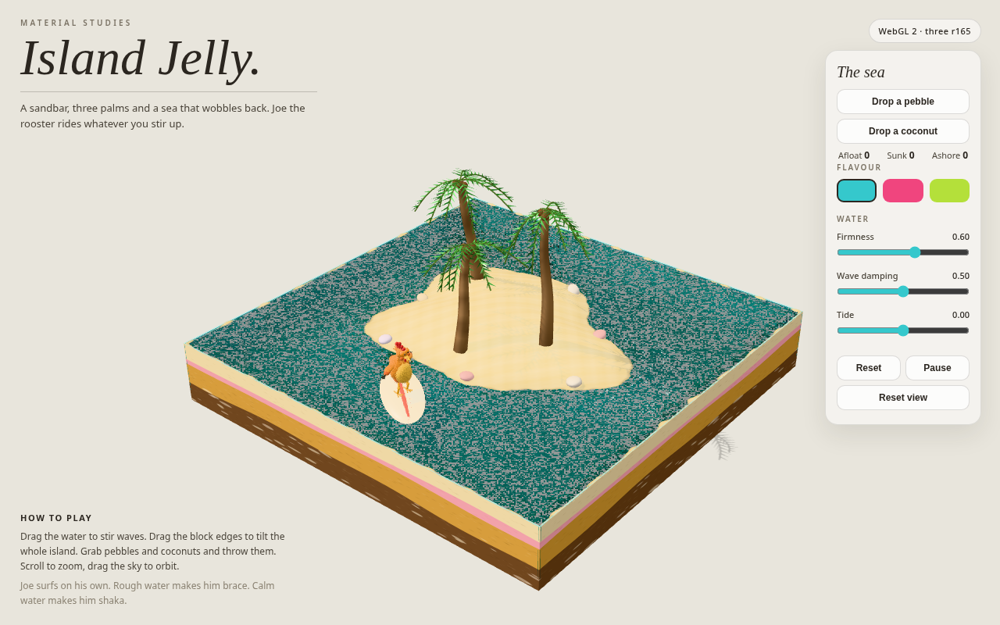
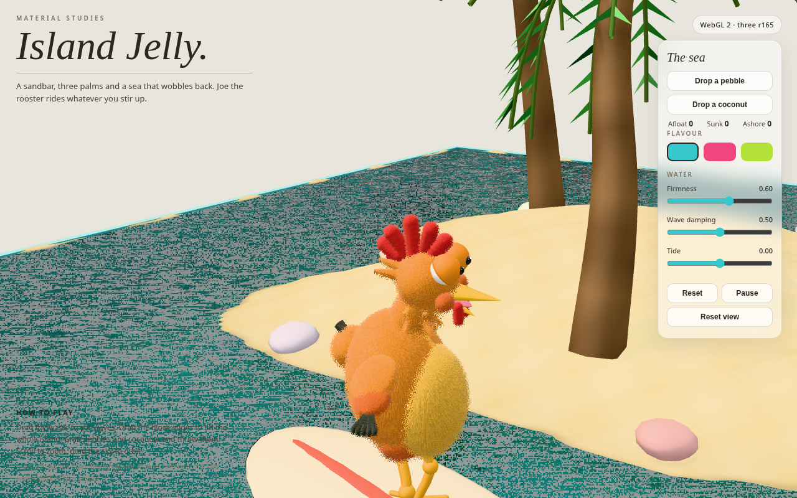
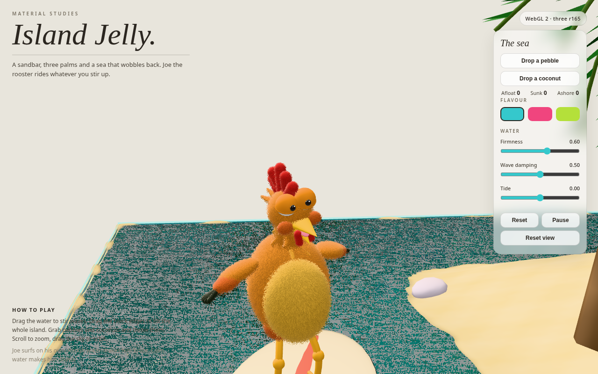

# Island Jelly

An interactive 3D diorama: a sandbar, three palms, and a sea that wobbles
back. Joe the rooster — plush, sleepy-eyed, surfing in a permanent slouch —
rides whatever you stir up.

Single self-contained `index.html`. No build step, no assets. three.js r165
via an importmap from jsDelivr.





## Run it

Module scripts + importmap need HTTP, so don't open the file directly:

```sh
python3 -m http.server 8000
# open http://localhost:8000/
```

Or any static server (`npx serve`, `npx http-server`, …).

## Play

- **Drag the water** — stir waves. Drag the block's sides — tilt it; the sea
  sloshes to the new level. Scroll to zoom, drag empty space to orbit.
- **Drop a pebble / Drop a coconut** — pebbles sink, coconuts float. Both
  splash, roll, wash ashore, and refloat when the tide rises.
- **Grab any pebble or coconut** and flick it to throw.
- **Flavour** swatches recolor the sea. **Firmness / Damping / Tide** sliders
  change how the jelly behaves.
- **Reset** clears the sea and the props. **Pause** freezes the sim.

Joe surfs on his own: he circles the island, rides the averaged surface
under his board, catches air off big waves, and grooves — hips on the
half-beat, head nodding behind it, right wing easing into a lazy shaka when
the water calms. His lids are heavy; he blinks slow.

## How it works

Everything lives in one file, built slice by slice (see
[DECISIONS.md](DECISIONS.md) for why each piece is the way it is). The page
is structured as: scaffold + UI → terrain → palms → sea → fur → Joe's body
→ Joe's head → surfing + groove → props.

### The island

A 160×160 heightfield over a 10×10 block. The island is a perturbed-ellipse
dome (radii 2.9 × 2.5, wobbled by a few sines) falling off exponentially
into a seabed at −0.85, with the rim rising to the waterline at the block
walls. A custom terrain shader — fed by the water's Laplacian texture — does
three things the geometry can't: it darkens wet sand near the waterline,
draws a thin dark waterline, and paints animated caustics that focus where
the water focuses. The block's four sides wear a procedural canvas of
sediment strata (cream sand, a pink band, ochre, dark brown) with wavy,
seamless boundaries; pastel rim pebbles sit just inside the waterline.
Placement is seeded, so the island is identical on every load.

### The sea

A 100×100 heightfield wave simulation running at a fixed 1/120 s step
(accumulator, max 8 substeps per frame), so firmness feels the same at any
frame rate. Each step: a 5-point Laplacian wave term (stiffness from the
Firmness slider), a spring pulling the surface back toward a tilted
equilibrium plane, and per-step damping (Damping slider). Land cells are
masked from the terrain height and recomputed when Tide moves.

The equilibrium plane is the interesting bit: it is derived from the
diorama's actual rotation matrix, so when you drag the block's sides and
tilt it on its damped spring, the water's rest plane tilts with it — the
sea genuinely sloshes to the new level, and the terrain's waterline follows
the same plane. The rendered surface is a 100×100 mesh whose vertices sit
at the sim's cell centres, so what you see is exactly what the physics
simulates — with one refinement: the mesh is *render-interpolated* between
sim steps. The ticker snapshots the heightfield before each frame's fixed
steps, then renders `prev + (current − prev) × alpha` where `alpha` is the
leftover sim fraction, so the water glides smoothly instead of jumping a
whole 1/120 s step per frame (which reads as jitter at low frame rates).
with a scrolling procedural ripple normal map, plus a transmissive skirt
around the perimeter that follows the edge height, with bright highlight
lines on top. Stirring drags a Gaussian disturbance along the pointer path;
random drips keep the sea alive. `sampleWater(x, z)` (bilinear height +
gradient) and `disturb(...)` are the API the surfer and the props use.

### The fur

Plush is a shader, not geometry. Each fur part is a base mesh plus 10
shells, each pushed out along its normal by `shell × len` with a gravity
droop (`grav × shell² × len`). The fragment shader splits UV space into
cells (default 220 × 110), puts one round strand per cell with a random
height (0.4–1.0) and a jittered centre, and discards fragments outside the
strand or above its height — so strands taper toward the tip and thin out.
Shading runs from 0.58 at the roots to 1.07 at the tips with per-strand
variation, over a sheen-tinted physical material. All fur shares one
program (one `customProgramCacheKey`); materials are cached per
(color, shell, len, rep, grav). Only the base shell casts shadows. Two
rules keep it correct: transforms are baked into the geometry (scaling a
fur group would squash the shader displacement — groups only translate),
and spiky parts (mane cones, tail spikes, wing fingers, comb lobes) are
merged into as few geometries as possible before being furred once.

### Joe

Hierarchy: `surfer (×1.35) → boardTilt → board + rooster (×0.56, yaw 0.5)
→ bodyGroup (sways, origin at the feet)`. The board is a clearcoated cream
flattened sphere with a coral stripe and fin. Legs are felt tubes
(foot → knee → hip) with knobbly knees and four splayed capsule toes each.
The slouch is rust fur shorts, an orange torso ellipsoid leaning back, and
a yellow pot belly pushed forward. The neck is a long fur tube curving
forward. The head pivots at the neck top: a fur sphere, a back tuft, a
comb (red base blade + 5 fanned capsule lobes, middle tallest, merged into
one velvet-fur part), and the eyes — big glossy white spheres bulging
outside the head surface so the white cap pokes through the fur, with heavy
felt upper lids covering ~56% (right lid droopier), darker rim tori on the
lid edges, lower lids pushed up like smiling cheeks, and dark pupils with
tiny highlights in the visible white band. The beak is a wide flattened
cone with a hook bend (bend parameter clamped to avoid NaN), lower beak
hinged open 0.42 rad on a jaw group, dark mouth, pink tongue, rust cheek
puffs, two red wattles on flop pivots. The mane is 6 rings of fuzzy cones
(longer toward the bottom) plus a chest bib, merged into gold + orange fur
parts with roots buried in the neck. Wings use ZYX shoulder pivots: orange
forearm, rust mid-section, 5 dark finger feathers fanned and merged.
Tail is dark spikes on an orange fluffy base.

**Surfing.** Joe loosely circles the island (orbit steering toward radius
3.6, pushed downhill by the wave gradient, repelled from the island, soft
wall bounce, speed cap 1.2). Vertically he rides the surface averaged over
his board footprint: centre ×2, ±0.55 along heading, ±0.22 across, /6. A
firm spring pulls him to 0.01 above that average, his velocity eases toward
the surface's vertical speed, and a glue term holds him to dropping faces.
In the air, gravity ×1.8; upward velocity capped at 2.2. Hard clamps keep
him within −0.04 / +0.16 of the surface, airborne above 0.08, with a small
splash on hard landings. A wake of small negative disturbances trails the
board. Orientation yaws toward travel, tilts to the smoothed surface
normal, and leans from lateral acceleration. Gap median/max over the last
2 s are tracked (`window.__jelly.getGapStats()`, `?debug=1` overlay) — the
target is median ≈ 0.01, max ≤ 0.16.

**Groove.** Beat = `t × 2.4`. Hips sway on the half-beat; the head nods
0.6 rad behind the beat (stronger when calm), stays cocked ~0.14 rad and
slowly looks around; comb and wattles flop a further 0.6 rad behind the
head; jaw breathes; tail sways. Wings balance on rough water (lift with
energy, counter the board lean) and the right wing blends into a lazy
forward shaka with a slow wrist-twist wiggle as the water calms. Blink is
slow and sleepy: every ~4.2 s, lids close over ~0.5 s on a sine curve.

### The props

Pebbles (faceted pastel icosahedra) sink; coconuts (plush fur spheres)
float. Both run a state machine — `air / sinking / afloat / sunk / ashore /
grabbed` — with splash on entry (wave disturbance + an expanding fading
ring that bobs with the surface), buoyancy + drag + wave-gradient push,
terrain and wall collision, visual rolling with horizontal motion, washing
ashore, and refloating when the tide rises. States drive the Afloat /
Sunk / Ashore counters (updated only on change). Props are grabbable
(raycast, priority over stir/tilt) and throwable with velocity from the
last 120 ms of pointer motion, clamped to 3. Reset clears them.

`?debug=1` shows a live overlay (gap median/max, wave energy, draw calls).

`window.__jelly` exposes `params`, `state`, `scene`, `camera`, `controls`,
`diorama`, `spawn(kind)`, and `getGapStats()` for poking at it from the
console.

## Verify

```sh
node scripts/check.mjs              # syntax + structural invariants per slice
node scripts/browser/lean-verify.mjs  # runtime: console, gap stress, counts
node scripts/browser/verify.mjs       # runtime + screenshots (slow on headless GPU)
```

The browser checks serve the repo over HTTP and load it in headless
Chromium, with three.js + addons served from a local mirror of the exact
jsDelivr files (`scripts/browser/vendor/`) and the Google Fonts stylesheet
stubbed empty — same three.js r165 code, deterministic delivery, no
dependence on the sandbox egress proxy. `scripts/browser/package.json`
pins the Playwright version; `node_modules/` is gitignored.

## Decisions

See [DECISIONS.md](DECISIONS.md) — one row per slice, what was chosen and why.
